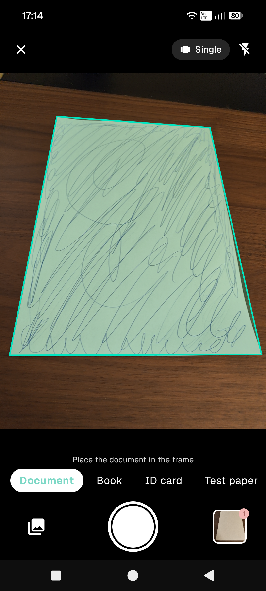
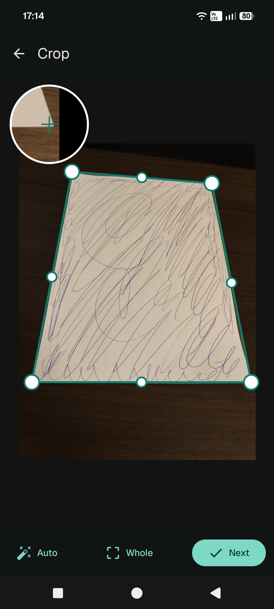

# Skryba

Skryba is a document scanner for Android. It works fully offline: no accounts, no ads,
no cloud. The only network feature is optional sharing over your local Wi-Fi via a link or
QR code, which you start yourself and which stops when you close it.

## Features

### Scanning

- Documents (single page or multi-page series), books (spread splitting), ID cards
  (front and back on one A4 page), tests (removes blue and red pen marks), whiteboards,
  slides, and photo-to-text.
- Live edge detection, manual corner adjustment with a magnifier, and automatic
  perspective correction.
- Filters: Auto, No shadows, Grayscale, Black and white, Brighten, Whiteboard,
  and Without answers.

### Conversions

- PDF to Word, Excel, PowerPoint, and JPG.
- Word, Excel, PowerPoint, TXT, and CSV to PDF.
- JPG to PDF.
- Scans without a text layer are recognized with OCR during conversion.

### PDF tools

- Merge, split, reorder, rotate, and delete pages.
- Watermark, signature, and compression.
- Password protection (AES-256) and password removal.
- Searchable PDF with a hidden text layer.

### Text recognition (OCR)

- Works offline in 41 languages, including Chinese, English, Japanese, Korean, and
  Polish. Pick the languages in Settings; English is selected by default.
- Search your library by file name or by the text inside documents.

### Files and sharing

- A library for your documents and files.
- Share by e-mail, messaging apps, or any other Android share target.
- Share over the local network with a link or QR code, or open your library from a
  computer's browser to download and upload files.
- ZIP backup instead of cloud sync.

### Offline smart tools

- Electronic signature.
- Old photo restoration.
- Tamper detection (error level analysis and metadata checks).
- Photoshop detection.
- Object counter.
- Mega scan: stitch several photos of a large document into one.

## Languages

The interface is available in English and Polish. It follows the phone language by
default and falls back to English. You can change it in Settings, or on Android 13+
in the system per-app language settings.

## Privacy

Everything is processed on your device. Skryba does not collect data, does not require
an account, and does not contain ads or trackers.

## Screenshots
<table>
  <tr>
    <td></td>
    <td></td>
  </tr>
</table>
